### Hi, I'm İlyas Serdar 👋

Senior DevOps Engineer · Computer Science graduate, Özyeğin University

4+ years building and running Kubernetes platforms on-premise, on AWS and
on Azure: CI/CD, infrastructure as code, observability, secret management
and DevSecOps. I also contribute to the open-source tools I use every day.

🥈 2nd place, Cisco Observability CTF (AppDynamics & Splunk)

#### Tech

**Cloud & IaC** 

**Containers** 

**CI/CD** 

**Observability** 

**Security & secrets** 

**Messaging & storage** 

**OS & scripting** 

**AI tools** 

#### Open source

- **[curl](https://github.com/curl/curl)**: keep IP info and connect time when connect fails ([commit](https://github.com/curl/curl/commit/354834bf905f58f7727df60d30eef7cac52f7df8), [#23319](https://github.com/curl/curl/pull/23319))  
- **[k9s](https://github.com/derailed/k9s)**: mark all rows in the table with ctrl-a ([#4256](https://github.com/derailed/k9s/pull/4256)) 
- **[k9s](https://github.com/derailed/k9s)**: suspend/resume all marked cronjobs ([#4255](https://github.com/derailed/k9s/pull/4255)) 

#### Contact

